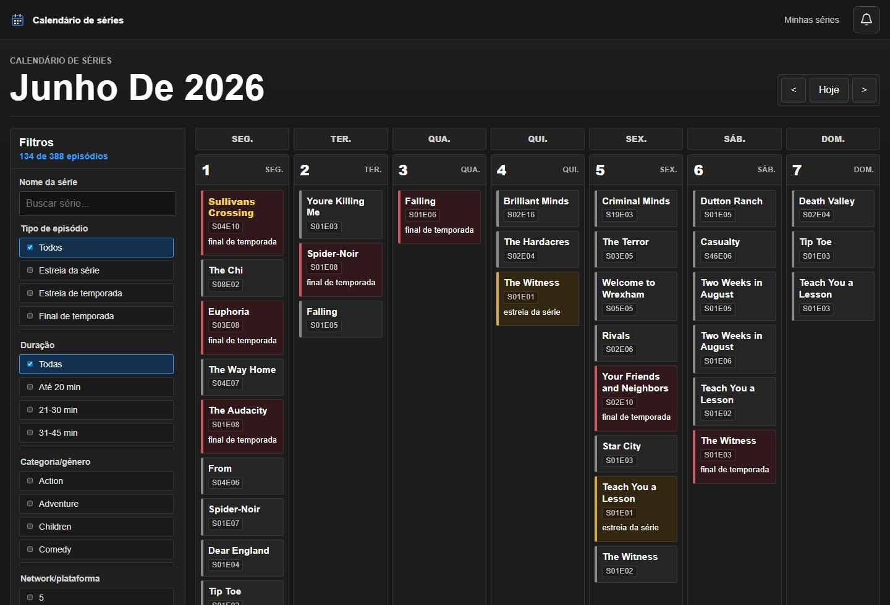
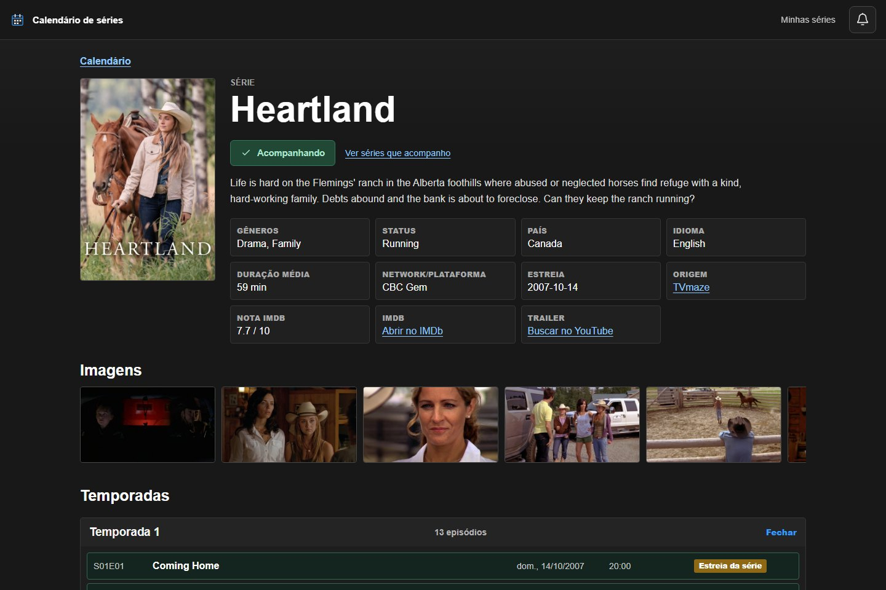
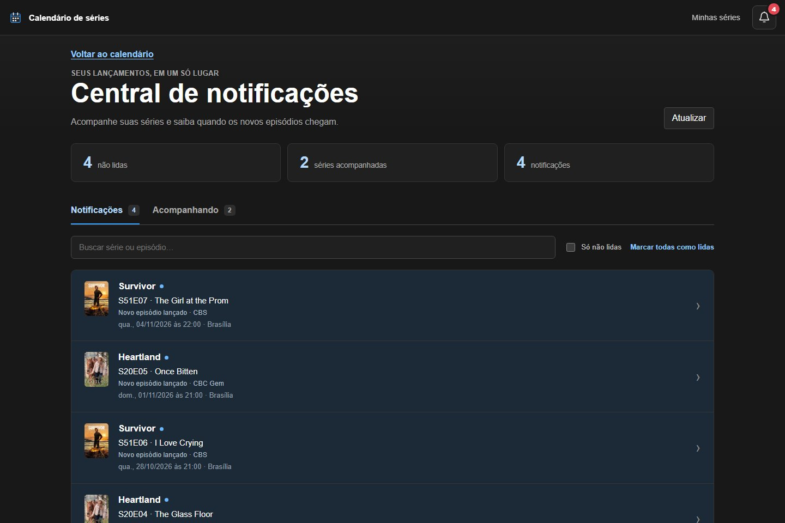

# Calendário de Séries

Veja o que estreia, volte a meses anteriores e acompanhe os próximos episódios das suas séries favoritas. O calendário está em português e os horários disponíveis são exibidos no fuso de Brasília.

[**Abrir o Calendário de Séries**](https://tv-shows-calendar.vercel.app/)

## Explore o calendário

Use as setas para navegar entre os meses ou clique em **Hoje** para voltar ao mês atual. Busque pelo nome da série ou filtre os episódios por tipo, duração, gênero, plataforma, país e idioma original. Os cartões sinalizam estreias e finais de temporada. Os nomes das séries que você acompanha aparecem em amarelo.



## Acompanhe uma série

Clique no cartão de uma série para ver a sinopse, a plataforma, as temporadas e a lista de episódios. Na página da série, selecione **Acompanhar série**. A aba **Acompanhando** da central reúne suas séries e mostra o próximo episódio quando o horário estiver confirmado.



## Veja os novos episódios

O sininho no cabeçalho mostra quantos avisos ainda estão pendentes. A central reúne os episódios com horário confirmado que saíram desde que você começou a acompanhar a série. Você pode buscar por série ou episódio, filtrar os avisos não lidos e marcar todos como lidos. Abrir um aviso marca aquele item como lido e mostra os detalhes do episódio.

Os avisos aparecem dentro do site. Se um episódio sair enquanto o site estiver fechado, ele aparece na próxima visita.



### Sua lista fica no seu navegador

Cada perfil de navegador tem sua própria lista de até 30 séries e seu próprio histórico de leitura. O acompanhamento é salvo automaticamente em um cookie criptografado, sem cadastro. Perfis diferentes têm listas separadas, mesmo no mesmo computador. Quem usa o mesmo perfil compartilha a lista. Limpar os cookies do site apaga o acompanhamento.

## Rodar localmente

Com Node.js 22.12 ou superior, instale as dependências e inicie o app. Abra o endereço indicado no terminal.

```bash
npm ci
npm run dev
```

## Hospedar na Vercel

Importe o repositório na Vercel com o preset **Vite**. O calendário, o catálogo e as notificações usam funções do próprio projeto. A Vercel é a única hospedagem necessária.

Para ativar as notificações, gere uma chave e salve-a em **Settings → Environment Variables** como `NOTIFICATIONS_SECRET` no ambiente de produção. Depois, faça o deploy.

```bash
node -e "console.log(require('node:crypto').randomBytes(32).toString('hex'))"
```

Mantenha a chave privada e use o mesmo valor nos deploys seguintes. Uma troca de chave invalida os acompanhamentos salvos.

## Fontes de dados

- O calendário mensal vem do [PogDesign](https://www.pogdesign.co.uk/cat/).
- Os detalhes das séries e episódios e os horários usados nas notificações vêm do [TVmaze](https://www.tvmaze.com/api#licensing).
